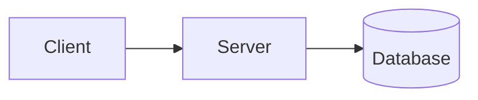

# Authoring guide

Everything you can use when writing content for this site (Hugo + the `apollo` theme). Posts live in
`content/posts/`, one Markdown file each. Preview with `hugo server`.

The examples below that contain fences use four backticks on the outside, so the inner three-backtick fences
show literally.

## Contents

* [Front matter](#front-matter)
* [Markdown basics](#markdown-basics)
* [Code blocks](#code-blocks)
* [Monospace blocks (not code)](#monospace-blocks-not-code)
* [Diagrams (mermaid)](#diagrams-mermaid)
* [Math](#math)
* [Shortcodes](#shortcodes)
* [Raw HTML](#raw-html)
* [Table of contents, tags, search](#table-of-contents-tags-search)

## Front matter

Posts use YAML between `---` lines (TOML between `+++` also works, as in `content/_index.md`).

```yaml
---
title: "Custom protocol handlers in Java"
published: 2016-04-20        # shown as "Published on"
updated: 2026-10-25          # optional, shown as "Updated on"
tags: [java, groovy]         # shown as #tags, each one links to /tags/<tag>/
description: "One line shown under the title in post lists"
tldr: "A short summary shown in a box above the post"
read_time: true              # shows "N Min Read" in the meta line
toc: false                   # hide the table of contents on this page
mathjax: true                # load MathJax on this page (see Math)
draft: true                  # not published; shows a DRAFT label with `hugo server -D`
---
```

`published` and `updated` are mapped to Hugo's `date` and `lastmod` in `hugo.toml`. "Updated on" only shows
when the day differs from the published day.

New files created with `hugo new content posts/<name>.md` start from `archetypes/default.md` as a draft.

## Markdown basics

Standard Markdown (Goldmark), with the usual extras.

````md
## A heading (h2 - the page title is the h1)
### A sub-heading

Plain text with *italic*, **bold**, ~~strikethrough~~ and a [link](https://gohugo.io).
Inline `code` goes in single backticks.

* Bullet
* Another bullet
    * Nested bullet

1. Numbered
2. List

> A blockquote, shown with a colored bar on the left.

---

| Column A | Column B |
| -------- | -------- |
| one      | two      |


````

* Headings get an anchor link and feed the table of contents.
* `---` on its own line draws a horizontal rule.
* End a line with two spaces (or a backslash) for a line break inside a paragraph.
* Links inside the text get a colored underline.
* Put images next to the post in a page bundle (`content/posts/my-post/index.md` + `image.jpg`), or in
  `static/` and reference them as `/image.jpg`.

## Code blocks

A fenced block with a language name. The language is required: `guessSyntax = false` in `hugo.toml`, so a
fence without one is shown as plain, uncolored text. The theme adds a language label and a copy button.

````md
```java
public class Hello {
    public static void main(String[] args) {
        System.out.println("Hello");
    }
}
```
````

Common languages: `java`, `xml`, `sh`, `powershell`, `toml`, `yaml`, `json`, `js`, `ts`, `html`, `css`, `sql`,
`python`, `go`, `rust`, `dockerfile`, `nginx`, `md`. Use `text` for no highlighting.

Chroma options go in braces after the language:

````md
```java {linenos=true, hl_lines=[2,"4-5"]}
...
```
````

Colors for the light and dark themes come from `themes/apollo/assets/css/components/syntax-light.css` and
`syntax-dark.css`; the label colors are in `code.css`.

## Monospace blocks (not code)

For console output, file trees, ASCII art or anything else that should be in JetBrains Mono but is not source
code. No language label, no copy button, no highlighting. The text is shown verbatim (not parsed as Markdown);
`<` and `&` are escaped for you.

````md

$ ls -l
-rw-r--r--  1 bogdan  staff  1024 Oct 25 21:42 notes.txt
drwxr-xr-x  3 bogdan  staff    96 Oct 25 21:42 images

````

Defined in `layouts/_shortcodes/mono.html`.

## Diagrams (mermaid)

A fence tagged `mermaid` is rendered as a diagram. Mermaid is loaded from a CDN only on pages that use one.

````md

````

## Math

Passthrough is enabled, so MathJax can render LaTeX. It is off by default; turn it on for a page with
`mathjax: true` in the front matter (or for every page with `mathjax = true` under `[params]`).

````md
Inline: $E = mc^2$ or \(a^2 + b^2 = c^2\)

Block:

$$
\int_0^1 x^2 \, dx = \tfrac{1}{3}
$$
````

## Shortcodes

Written as `...`. The body of `note`, `character` and `accent` is Markdown.

### note

A highlighted box, optionally with a header, collapsible. Used at the top of the posts republished from the
past.

````md

A plain note. The body is *Markdown*.



A note with a header bar.



A collapsible note, collapsed at first. `hidden=false` starts it expanded.



`center=true` centers the header text instead of showing the pencil icon.

````

| Parameter   | Meaning                                                              |
| ----------- | -------------------------------------------------------------------- |
| `header`    | Markdown for the header line. Without it, no header bar is shown     |
| `clickable` | Turn the header into a toggle button                                 |
| `hidden`    | With `clickable`: start collapsed                                    |
| `center`    | Center the header text instead of showing the pencil icon            |

### character

A comment bubble with a character next to it.

````md

What the character says. *Markdown* works.

````

| Parameter  | Meaning                                                                          |
| ---------- | -------------------------------------------------------------------------------- |
| `name`     | Character name, default `hooded`. Without an image it is shown as text           |
| `position` | `right` (default) or `left`                                                      |
| `type`     | CSS modifier, default `comment`                                                  |
| `image`    | A file in `static/images/characters/` to use as the avatar (`hooded.png` is built in) |

### accent

Inline text in the site's accent color.

````md
My first job in IT was in 2004.
````

### quote-of-the-day

A random quote from `data/quotes.toml`, picked in the browser on every page load. Used on the home page. Add
quotes by appending to `data/quotes.toml`.

````md

````

### mono

See [Monospace blocks (not code)](#monospace-blocks-not-code).

## Raw HTML

`unsafe = true` is set in `hugo.toml`, so HTML can be written directly in a post. The home page hero block
(`content/_index.md`) is made this way:

````md
<div class="homepage-hero">
  <h1 class="homepage-hero-title">Welcome</h1>
  
</div>
````

Available theme CSS classes include `primary-color` (accent color text), `homepage-hero`,
`homepage-hero-title` and `homepage-hero-subtitle`. Colors are CSS variables (`--primary-color`, `--text-0`,
`--bg-1`, `--border-color`, ...) defined in `themes/apollo/assets/css/components/theme.css`, so they follow the
light/dark toggle.

## Table of contents, tags, search

* The table of contents appears on the right of pages that have headings. Disable it per page with
  `toc: false`.
* Tags are listed at `/tags/`, and each tag has its own page.
* The search button (or `Ctrl/Cmd + K`) searches the site through the JSON index generated for the home page.
